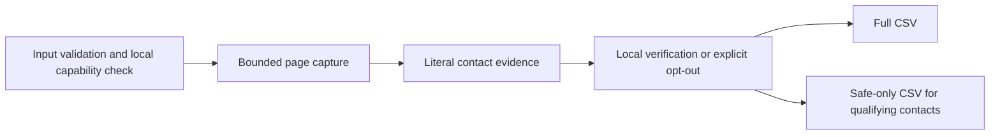

# FridayOutreach

[](https://github.com/GopalGB/FridayOutreach/actions/workflows/verify.yml) [](https://github.com/GopalGB/FridayOutreach/releases)

FridayOutreach turns approved public websites into source-linked CSVs for review. Its deterministic local core preserves all observations in a full CSV and writes a strict safe-only CSV when local mailbox checks qualify a contact. It is ready for a trusted function-calling host through its documented local agent runner.

- Collect tables or repeated cards with explicit recipes, then review, edit or exclude records before export.
- Extract published contacts with their source URLs and observation times.
- Keep every verification outcome in the full CSV and get a separate safe-contact CSV automatically.
- Use the CLI, the installed Codex skill, or the [provider-neutral agent function](integrations/fridayoutreach-function-tool.json).

## Start with the local core

```sh
git clone https://github.com/GopalGB/FridayOutreach.git
cd FridayOutreach
python3 scripts/setup.py --core
.venv/bin/python -m lead_collector preview --html example.html --source-url https://source.example.test/directory --mapping '{"Name":"company"}'
```

This checked-in preview reads fictional HTML locally: it needs no HTTP, SMTP, AI, credentials, or native runner. For the installed commands below, run `python3 scripts/setup.py --install` once to add the `fridayoutreach` launcher and Codex skill. `lead-collector` remains a compatible alias. You can also replace `fridayoutreach` with `.venv/bin/python -m lead_collector` from the clone. The [getting-started workflow](docs/GETTING-STARTED.md) covers directory collection and review.

For an offline enrichment demonstration, create new files in a directory you own. A blank `website` prevents HTTP fetches; `--skip-email-verification` disables SMTP verification, not HTTP:

```sh
FRIDAY_DEMO_DIR="$(mktemp -d "${HOME}/friday-demo.XXXXXX")"
printf '%s\n' 'company,website' 'Fictional Offline Co,' > "$FRIDAY_DEMO_DIR/offline-input.csv"
fridayoutreach enrich --input "$FRIDAY_DEMO_DIR/offline-input.csv" --output "$FRIDAY_DEMO_DIR/offline-results.csv" --skip-email-verification
```

This creates `offline-results.csv` and `offline-results.safe.csv` in the new demo directory. The full CSV records `no_website`; the safe CSV is header-only because verification was explicitly skipped. For a normal verified run, first follow the separate [local Reacher runner setup](scripts/reacher_smtp_runner/README.md), then run:

```sh
fridayoutreach enrich --input businesses.csv --output businesses.enriched.csv
```

The native runner is a local prerequisite and is not included in core. On the default path, a missing trusted runner fails before HTTP fetching or output writing.

## Output and boundaries

The full CSV records source observations and statuses, including non-qualifying and error outcomes. The safe projection includes only literal source-observed addresses with a `safe` native result, confirmed mailbox, true syntax/MX/SMTP values, false catch-all/disabled/full-inbox values, and no verification error. See the exact [output schema](docs/OUTPUT-SCHEMA.md) and measured [verification report](docs/VERIFICATION.md).



The diagram shows order, not a promise of any result: default enrichment checks the local verifier before capture; an explicit opt-out records unverified results and cannot qualify safe contacts. Deterministic extraction uses no AI. ScrapeGraphAI is optional and local; Jev live execution is UNRUN and cost-guarded. Windows is not tested.

## Documentation and contribution

- [Getting started](docs/GETTING-STARTED.md)  -  preview, collection, review, export, and enrichment.
- [Architecture](docs/ARCHITECTURE.md)  -  validation and data flow.
- [Output schema](docs/OUTPUT-SCHEMA.md) and [troubleshooting](docs/TROUBLESHOOTING.md).
- [Agent usage](docs/AGENT-USAGE.md)  -  trusted local function-host contract.
- [Contributing](CONTRIBUTING.md), [roadmap](ROADMAP.md), and [security policy](SECURITY.md).

If FridayOutreach is useful, a star helps others discover it.

## Evidence and license

The verification report records two 368-test native-host passes and two recorded 22-business/48-check replays with four safe results. Those are measured local evidence, not a benchmark; no raw real leads are public. The repository has no root license grant yet; [issue #7](https://github.com/GopalGB/FridayOutreach/issues/7) tracks the maintainer’s license decision.
