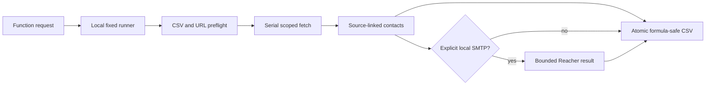

# Lead Collector

Lead Collector is a local-first scraper for fictional or explicitly approved public pages. It extracts company rows and published contact links into a reviewable SQLite job. It does not send leads or perform outreach.

## Quick start

```sh
git clone https://github.com/GopalGB/lead-collector.git
cd lead-collector
python3 scripts/setup.py --core
.venv/bin/python lead.py doctor
```

`--core` installs only the hash-locked local wheels. It does not contact an index, start a model service, pull a model, discover credentials, or call a provider. `--install` adds the optional local launcher and skill; the launcher is `~/.local/bin/lead-collector`.

Run `python3 scripts/setup.py --install` to install that launcher, or replace
`lead-collector` in the examples with `.venv/bin/python lead.py` from the clone.

## Reviewable offline workflow

```sh
lead-collector collect --html example.html --source-url https://source.example.test/directory --mapping '{"Name":"company"}'
# Copy the returned job ID and row ID from the JSON envelope.
lead-collector review --job JOB_ID --query fictional --sort company
lead-collector export --job JOB_ID --format json --output review.json --row ROW_ID
```

The default state is `~/.local/share/lead-collector/jobs.sqlite3`. `--state` accepts a simple filename or a direct leaf inside that managed private directory. External, nested, traversal, and protected paths are rejected. Use `edit`, `exclude`, `snapshot`, and `import` for human-controlled review. JSON export is lossless; CSV is a projection. Existing output files are preserved unless `--overwrite` is explicit.

The CLI supports `collect`, `contacts`, `control`, `resume`, `snapshot`, `review`, `edit`, `exclude`, `export`, `import`, `recipe`, `clear`, and `assist`. Collection is bounded by explicit host/path, page, row, redirect, size, and timeout limits. `clear` requires confirmation.

`assist --ai off` uses captured HTML only and has no optional AI dependency. ScrapeGraphAI is optional: only after Ollama is already running locally and `qwen3:0.6b` is installed, use:

```sh
lead-collector assist --html example.html --source-url https://source.example.test/directory --mapping '{"Name":"company"}' --ai scrapegraph --model ollama/qwen3:0.6b
```

No daemon or model pull is automatic. Jev preview/replay are contract-only in this build; live Jev remains UNRUN and cost-guarded. Do not use `--allow-metered-jev` without separate explicit authorization.

`--ai` uses user-level `uv` and Python 3.12 for the optional lock, with fixed public PyPI and no inherited configuration or proxy settings. Missing artifacts, Python, or developer tools return named errors.

## Optional SMTP-only email verification

`verify-email` is an explicit, local operation. Ordinary collection and `doctor` never install, start, or probe the optional verifier. Give it only an address already observed in page evidence:

```sh
lead-collector verify-email --email "$PUBLISHED_EMAIL"
# Or use a separately built, owner-only runner:
lead-collector verify-email --email "$PUBLISHED_EMAIL" --reacher-binary /absolute/path/reacher-smtp-check
```

The default runner location is `.tools/reacher-smtp-check`. Its source is [the SMTP-only Reacher runner](scripts/reacher_smtp_runner/README.md); it is deliberately not downloaded or built by the CLI. The runner binds Reacher v0.11.11 to direct SMTP for every provider class, disables Gravatar and Have I Been Pwned checks, inherits no proxy, credential, or provider environment variables, and never sends SMTP `DATA` or a message.

The JSON result retains `safe`, `risky`, `invalid`, or `unknown`. `mailboxVerified` is true only for a typed `safe` response whose exact input matches the requested address and whose syntax, MX, and SMTP deliverability are affirmative with no catch-all, disabled, or full mailbox. Missing runtime, timeouts, malformed output, contradictions, and uncertain server responses remain unverified named errors.

## Bounded CSV enrichment

Clone `GopalGB/lead-collector`, use Python 3.11+, and bootstrap only the core
offline wheel set when it is supplied with the checkout:

```sh
python3 scripts/setup.py --core
python3 scripts/setup.py --install  # optional launcher
lead-collector enrich --input businesses.csv --output businesses.enriched.csv
```

`enrich` is serial, deterministic, and AI-free. It preflights all rows, paths,
collision rules, and public HTTP(S) targets before the first fetch. It preserves
original fields and adds raw `published_emails`, JSON `email_evidence`, JSON
`email_verification`, `site_status`, and JSON `site_evidence`; every CSV cell
is formula-safe. Defaults are 20 sites, 3 pages/site, and 100 unique checks;
hard caps are 100, 5, and 1,000.

Verification is opt-in and uses only a trusted local Reacher runner:

```sh
lead-collector enrich --input businesses.csv --output businesses.enriched.csv --verify-emails --max-sites 20 --max-pages-per-site 3 --max-emails 100
```

No SMTP occurs without `--verify-emails`. Missing runtime fails before work;
uncertain, risky, invalid, unknown, and over-limit checks are never mailbox
verified. Native source/build prerequisites are in
[`scripts/reacher_smtp_runner/README.md`](scripts/reacher_smtp_runner/README.md).

## Agent invocation

An agent model requests `lead_collector_enrich`; its trusted tool host executes
the local runner. A text-only model cannot execute a URL or local process.

```sh
printf '%s\n' '{"input_csv":"businesses.csv","output_csv":"businesses.enriched.csv","max_sites":20}' | .venv/bin/python scripts/agent_tool.py --workspace "$PWD"
```

The provider-neutral schema is `integrations/function-tool.json`. The runner
accepts one JSON object of at most 64 KiB, known bounded fields, and relative
CSV paths confined to its host workspace. Repeated JSON fields are rejected,
as are absolute paths, traversal, protected names and symlinked components. It invokes a
fixed CLI argument list with no shell, SDK, or executable override.



Examples are fictional. This project makes no universal-site or all-mailboxes-
verified claim. Existing third-party license notices and native prerequisites
are included with the corresponding components.

## Development checks

From a source checkout with the core runtime installed, run `python3 scripts/verify.py`. It runs only local doctor, unit, Ruff, and strict MyPy checks; it never installs dependencies or activates optional AI.
