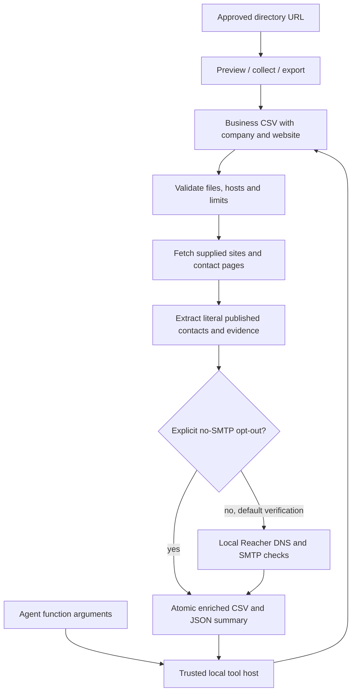

# Agent usage

The model selects `lead_collector_enrich` from `integrations/function-tool.json`.
The host validates the request and runs `scripts/agent_tool.py` in a trusted
workspace. A model that can only produce text cannot execute a GitHub URL or
local process by itself.

The runner accepts one JSON object of at most 64 KiB and requires relative
`input_csv` and `output_csv` paths.
Optional booleans are `verify_emails` and `overwrite`; `verify_emails` defaults to
`true` and can be explicitly set to `false` for the no-SMTP path. Optional integer caps are
`max_sites` (100), `max_pages_per_site` (5), and `max_emails` (1000). Defaults
are 20, 3, and 100. Duplicate JSON keys, absolute paths, `..`, unknown keys,
symlink traversal, and malformed types are rejected before work. The trusted
host supplies `--workspace`; model arguments cannot select an executable or
leave that workspace.

For a direct CLI workflow:

```sh
lead-collector enrich --input businesses.csv --output businesses.enriched.csv
```

The batch path is deterministic and does not call AI. It preflights every CSV
row, option cap, collision rule, and public HTTP(S) target before any fetch;
then it fetches serially only within the supplied host plus its bare/www
counterpart. Output preserves original fields and adds raw `published_emails`,
JSON `email_evidence`, JSON `email_verification`, `site_status`, and JSON
`site_evidence`. Verification is the default and requires a trusted local Reacher runtime;
Normal verification preserves safe, risky, invalid, unknown, and
not-checked-limit outcomes. `--skip-email-verification` is a separate explicit
no-SMTP opt-out.

A function-calling host registers the schema's name and `input_schema` with
its model provider. When the model requests `lead_collector_enrich`, the host
passes only the argument object to this local runner. For example:

```python
import json
from pathlib import Path
import subprocess

def call_lead_collector(arguments, workspace, checkout):
    checkout = Path(checkout).resolve()
    completed = subprocess.run(
        [str(checkout / ".venv/bin/python"),
         str(checkout / "scripts/agent_tool.py"),
         "--workspace", str(Path(workspace).resolve())],
        input=json.dumps(arguments), text=True, capture_output=True, check=False,
    )
    return json.loads(completed.stdout)
```

The host returns that JSON envelope to the model. An `ok: false` response is
a named failure, not an empty successful scrape. Read the output CSV only
after success, and treat each address's `mailboxVerified` independently from
the fact that a publisher listed it.


