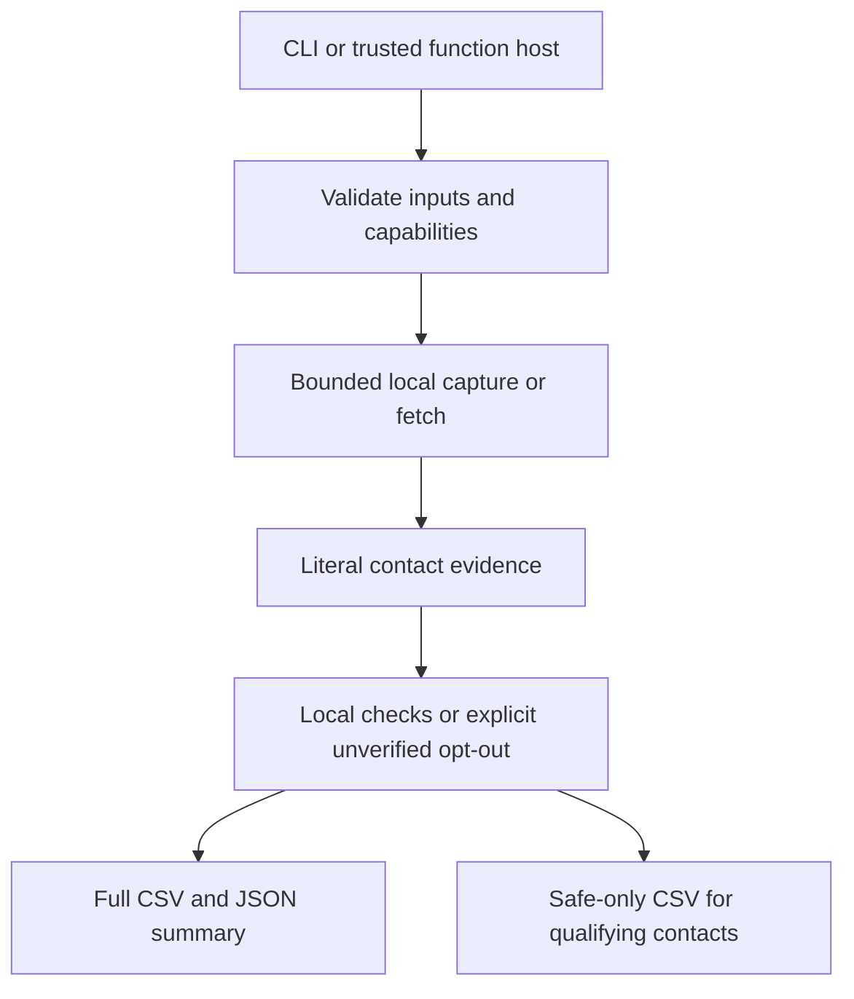
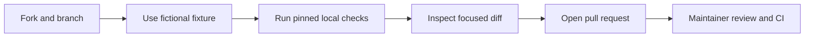

# Architecture

FridayOutreach is a local, bounded pipeline. It validates CSV paths, output collisions, public HTTP(S) targets, limits, and - in the default enrichment path - the trusted local verifier before capture. Collection stores reviewable jobs; enrichment fetches serially inside the supplied host boundary and keeps literal published-contact evidence.

On default enrichment, an unavailable verifier stops before HTTP and before output writing. An explicit opt-out still permits bounded capture but produces unverified full-output contacts and no safe qualifiers. The safe CSV is a strict projection, not a second source of truth.

| Component | Responsibility |
| --- | --- |
| `lead.py`, `lead_collector/cli.py` | CLI arguments and named JSON result envelopes. |
| `lead_collector/batch.py` | Bounded CSV enrichment and strict safe-contact projection. |
| `lead_collector/transport.py`, `fetch_child.py` | Scoped HTTP capture and network boundaries. |
| `lead_collector/extract.py`, `model.py` | Literal parsing and per-value source evidence. |
| `lead_collector/email_verify.py` | Typed adapter for the separate local Reacher runner. |
| `lead_collector/jobs.py`, `store.py` | Reviewable job state, controls and local storage. |
| `scripts/agent_tool.py` | Fixed operation for a trusted model tool host. |

AI is outside deterministic extraction: ScrapeGraphAI is an optional local path, and Jev is contract-only with live use UNRUN. The fixed agent runner accepts bounded JSON and invokes a fixed CLI argument list; it cannot select a shell, executable, provider, or arbitrary workspace. See [Agent usage](AGENT-USAGE.md).

## Contributor flow

Do not hand-edit generated locks or release metadata; a maintainer regenerates the manifest. Planned work is linked in [ROADMAP.md](../ROADMAP.md).
